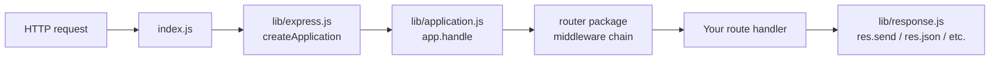

# Analyze this repo and explain its architecture in plain language for a new developer joining the team. Then suggest 2 small, beginner-friendly starter tasks.

---

**Status:** active  **Date:** 2026-09-27

---

### 👤 User

Analyze this repo and explain its architecture in plain language for a new developer joining the team. Then suggest 2 small, beginner-friendly starter tasks.

---

### 🤖 Assistant

> 🔧 called: list_files

> 🔧 **list_files** — .

### 🤖 Assistant

> 🔧 called: read_file, list_files, list_files

> 🔧 **list_files** — lib

> 🔧 **list_files** — test

> 🔧 **read_file** — package.json

### 🤖 Assistant

> 🔧 called: read_file, GetSymbolsOverview, GetSymbolsOverview

> 🔧 **read_file** — index.js

> 🔧 **GetSymbolsOverview** — lib/express.js

> 🔧 **GetSymbolsOverview** — lib/application.js

### 🤖 Assistant

> 🔧 called: GetSymbolsOverview, GetSymbolsOverview, GetSymbolsOverview

> 🔧 **GetSymbolsOverview** — lib/request.js

> 🔧 **GetSymbolsOverview** — lib/response.js

> 🔧 **GetSymbolsOverview** — lib/view.js

### 🤖 Assistant

> 🔧 called: read_file, list_files

> 🔧 **list_files** — examples

> 🔧 **read_file** — lib/express.js

### 🤖 Assistant

Here's a thorough breakdown of the codebase for a new developer, followed by two starter tasks.

---

## Architecture Overview

**Express** is a minimal Node.js HTTP web framework. The entire publishable source lives in six files under [`lib/`](lib/) — everything else is tests, examples, or tooling.

### How a request flows through the system

### File by file

| File | Role |
|---|---|
| [`index.js`](index.js) | Trivial entry point — just re-exports `lib/express.js` |
| [`lib/express.js`](lib/express.js) | **Factory.** `createApplication()` builds the `app` function by mixing `EventEmitter`, `application.js` methods, and the req/res prototypes together into a single callable object. Also re-exports public API surface (`express.json`, `express.static`, `express.Router`, etc.) |
| [`lib/application.js`](lib/application.js) | **The app object.** All the methods you call on `app`: `app.use()`, `app.get/post/…()`, `app.route()`, `app.listen()`, `app.render()`, `app.set()`/`app.enable()`/`app.disable()`. Delegates all routing to the external `router` npm package. |
| [`lib/request.js`](lib/request.js) | **Augmented `req`.** A prototype that extends Node's `http.IncomingMessage`. Adds convenience properties like `req.ip`, `req.hostname`, `req.protocol`, `req.query`, `req.fresh`/`req.stale`, and content negotiation helpers (`req.accepts()`, `req.is()`). |
| [`lib/response.js`](lib/response.js) | **Augmented `res`.** A prototype that extends Node's `http.ServerResponse`. Adds all the response helpers: `res.send()`, `res.json()`, `res.redirect()`, `res.render()`, `res.cookie()`, `res.sendFile()`, `res.download()`, etc. |
| [`lib/view.js`](lib/view.js) | **Template renderer.** A small `View` class that resolves a template name to a file path, picks the right engine (e.g. EJS, Handlebars), and calls it. Used internally by `app.render()` and `res.render()`. |
| [`lib/utils.js`](lib/utils.js) | **Shared helpers.** Utility functions used across the other files: ETag compilation, query parser selection, trust-proxy compilation, MIME type normalization, etc. |

### Key design decisions worth knowing

1. **`app` is just a function.** `createApplication()` returns a plain JS function `(req, res, next) => app.handle(req, res, next)`. Methods are mixed in with `merge-descriptors`. This means you can pass it directly to `http.createServer(app)`.

2. **Routing is fully delegated.** Express does not contain its own router implementation. It uses the standalone [`router`](https://www.npmjs.com/package/router) npm package. That means [`lib/application.js`](lib/application.js) just proxies `.use()`, `.route()`, `.param()`, and the HTTP-method shortcuts through to that package.

3. **`req` and `res` are prototype chains.** Node's native `IncomingMessage` and `ServerResponse` are the bases. Express's versions extend them with `Object.create()`. When `createApplication()` runs, each app gets its own `req`/`res` clone so you can customize per-app without polluting the global prototypes.

4. **Middleware parsers are re-exported, not reimplemented.** `express.json()`, `express.urlencoded()`, `express.raw()`, and `express.text()` are simply re-exported from the `body-parser` package. `express.static` comes from `serve-static`.

### Test layout

The [`test/`](test/) folder mirrors the public API one-to-one. Each file is named after what it tests: [`test/req.hostname.js`](test/req.hostname.js), [`test/res.json.js`](test/res.json.js), [`test/app.use.js`](test/app.use.js), etc. Tests use **Mocha** + **Supertest** (which lets you fire real HTTP requests without a running server).

---

## Two Beginner-Friendly Starter Tasks

### Task 1 — Add a missing `req.get()` test case

**File:** [`test/req.get.js`](test/req.get.js)

**Why it's good for beginners:** The pattern in every test file is identical — create a small Express app with `supertest`, fire a request, assert on the result. No complex setup. `req.get(name)` retrieves a request header. You can look at the implementation in [`lib/request.js`](lib/request.js:64) and find an edge case that has no test yet (e.g. a header name with mixed Unicode casing, or what happens when the same header appears multiple times).

**Concretely:** Open [`test/req.get.js`](test/req.get.js), find the existing `it(...)` blocks, add a new `it('should …', …)` block following the same shape, run `npm test` to confirm it passes.

---

### Task 2 — Add a `res.status()` validation for non-integer input

**File:** [`lib/response.js`](lib/response.js:65) + [`test/res.status.js`](test/res.status.js)

**Why it's good for beginners:** [`res.status(code)`](lib/response.js:65) is a tiny ~30-line function. Currently it checks for valid integer status codes and deprecated usage of strings. You can add a check that throws (or uses `http-errors`) when a float like `200.5` is passed — it is not a valid HTTP status code but currently slips through. Write the guard in [`lib/response.js`](lib/response.js), then add the corresponding test in [`test/res.status.js`](test/res.status.js). Run `npm test` to verify nothing breaks.